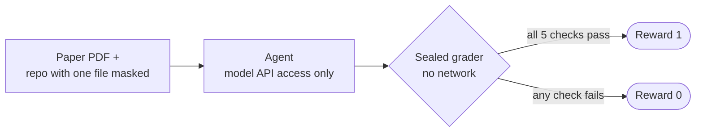

<div align="center">

# paper2eval

**Turn research papers into [Harbor](https://github.com/harbor-framework/harbor) evals that AI agents can't talk their way through.**

[Quickstart](#quickstart) · [First results](#first-results) · [How it works](#how-it-works) · [Add a paper](#add-your-own-paper)

</div>

---

An agent gets a real paper and the authors' code with the main method cut out. Its job is to put the method back.

Passing the repo's tests isn't enough. A valid but wasteful method can pass them, so the grader also compares the result
to the authors' version on the measure the paper cares about. No LLM judge, no partial credit: the code either matches
the paper or it doesn't.

## Quickstart

You need [uv](https://docs.astral.sh/uv/) and a running Docker daemon.

```bash
uv tool install harbor
git clone https://github.com/rishiskhare/paper2eval.git && cd paper2eval

# Check the setup: the reference solution scores 1
scripts/harbor.sh run -p tasks/pgm -a oracle
```

Then point a real agent at it, with `OPENAI_API_KEY` set:

```bash
scripts/harbor.sh run -p tasks/pgm -a codex -m openai/gpt-5.6-luna --allow-agent-host api.openai.com
```

Results land in `jobs/<timestamp>/`. The trace is in `agent/`, and the grader's output is in `verifier/test-stdout.txt`.

> [!NOTE]
> On a Mac, run `brew install colima` too. Docker Desktop can't enforce the agent's network block, so
> [`scripts/harbor.sh`](scripts/harbor.sh) switches to Colima for that one command and leaves your default Docker
> context alone.

## First results

GPT-5.6 Luna, running through Codex, took on the [PGM-index](https://github.com/gvinciguerra/PGM-index) task four times.
It scored **0 of 4**, with three kinds of failure:

| Run | Reward | What the grader caught | Cost |
|---|---|---|---|
| [`15-32-58`](jobs/2026-11-06__15-32-58/pgm__bL6bwse/verifier/test-stdout.txt) | **0** | Index build crashed on all 8 held-out datasets: `Unexpected intercept < 0` | $0.04 |
| [`15-43-22`](jobs/2026-11-06__15-43-22/pgm__GJCeirr/verifier/test-stdout.txt) | **0** | Changed build and test files outside the one allowed header | $0.05 |
| [`15-50-52`](jobs/2026-11-06__15-50-52/pgm__Z3Cg8bD/verifier/test-stdout.txt) | **0** | Too many segments on 21 of 24 cases, such as 377 against the optimal 276 | $0.09 |
| [`16-11-25`](jobs/2026-11-06__16-11-25/pgm__Cmk2due/verifier/test-stdout.txt) | **0** | Too many segments on all 15 cases, from 1% to 42% over the authors' counts | $0.03 |

The last two runs are the ones the eval exists to catch: lookups were correct on held-out data, but the segmentation
wasn't as good as the paper's method.

> [!IMPORTANT]
> This is one model on one task, so it's a demo of the grader rather than a benchmark. The first three runs used an
> earlier version of the grader, and two other runs were cancelled before grading.

<details>
<summary><b>Read the full trace of the latest run</b></summary>

- Agent trace: [`trajectory.json`](jobs/2026-11-06__16-11-25/pgm__Cmk2due/agent/trajectory.json) and
  [`codex.txt`](jobs/2026-11-06__16-11-25/pgm__Cmk2due/agent/codex.txt)
- Grader output: [`test-stdout.txt`](jobs/2026-11-06__16-11-25/pgm__Cmk2due/verifier/test-stdout.txt)
- Authors' counts: [`reference_counts.txt`](tasks/pgm/tests/reference_counts.txt)

</details>

## How it works



**The agent sees** the paper as a PDF and the repo with one file reduced to a placeholder. The repo's own tests stay in
place, and its internet is blocked except for its model API.

**The grader** runs in a separate container with no network. Cheap checks come first, so bad solutions fail fast:

| # | Check | What it rules out |
|---|---|---|
| 1 | Only the allowed file changed | Editing the tests or the build |
| 2 | A clean copy of the repo compiles with that file | Code that only works in the agent's sandbox |
| 3 | Results are correct on held-out data | Wrong answers and crashes |
| 4 | The result is as good as the authors' on the paper's metric | Valid methods that aren't the paper's |
| 5 | The repo's own tests pass | Regressions |

On the current grader, the reference solution scores 1 and an agent that does nothing scores 0.

The instruction reads like an ordinary developer request. It names the file and the paper, and never explains the
method or mentions grading.

## Tasks

| Task | Paper | The agent must rebuild | Status |
|---|---|---|---|
| [`tasks/pgm/`](tasks/pgm/) | [PGM-index](https://github.com/gvinciguerra/PGM-index), VLDB 2020 | Optimal piecewise linear segmentation | Ready |
| [`tasks/fsst/`](tasks/fsst/) | FSST | Not defined yet | Scaffold only |

Each task documents what it can't catch. See the [PGM-index limits](tasks/pgm/review/limits.md).

## Add your own paper

The [`paper-to-eval`](.claude/skills/paper-to-eval/SKILL.md) skill walks an agent through building a task from a paper
and its authors' repo. In Claude Code, from this repo:

```text
/paper-to-eval
```

A paper is a good fit when:

- Its contribution is one deterministic algorithm that lives in a single file or function.
- It defines "good", through an optimality claim or a tolerance a paper-only implementation can hit.
- Trusted code can check correctness, using the untouched repo or a simple brute force.
- It builds offline in minutes on Ubuntu 24.04, on amd64 and arm64.
- Its license allows redistribution.

## Repo layout

| Path | Contents |
|---|---|
| [`tasks/`](tasks/) | Harbor tasks, one folder per paper |
| [`scripts/harbor.sh`](scripts/harbor.sh) | Runs Harbor on a Docker engine that can enforce the agent's network block |
| [`.claude/skills/paper-to-eval/`](.claude/skills/paper-to-eval/) | The skill for building a new task |
| [`jobs/`](jobs/) | Past runs, including every trace above |

## License

[`tasks/pgm/repo/`](tasks/pgm/repo/LICENSE) keeps the PGM-index authors' Apache-2.0 license. The rest of this repo
doesn't have a license yet.
